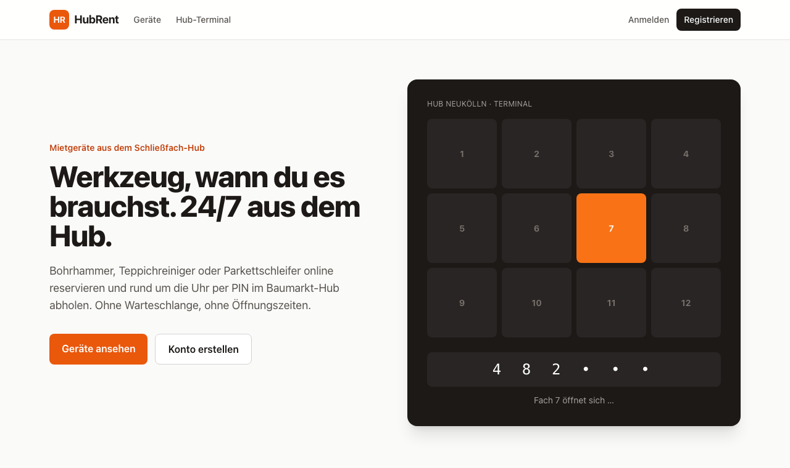
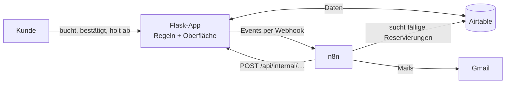
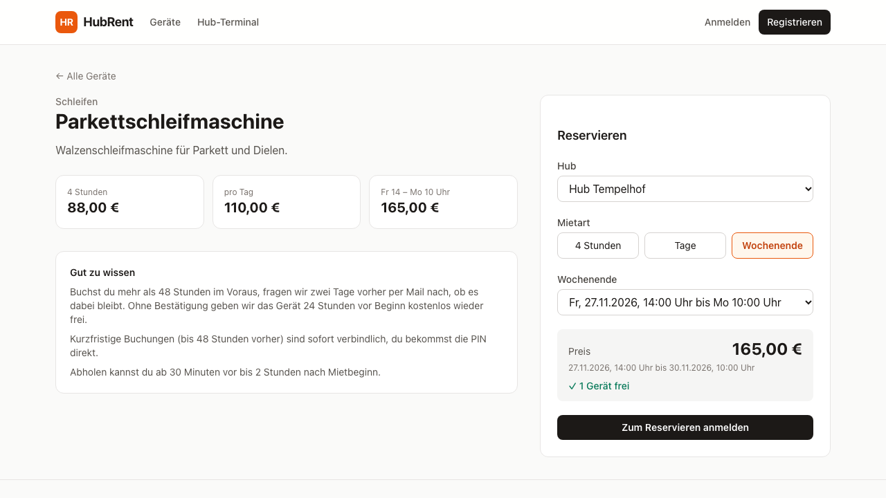
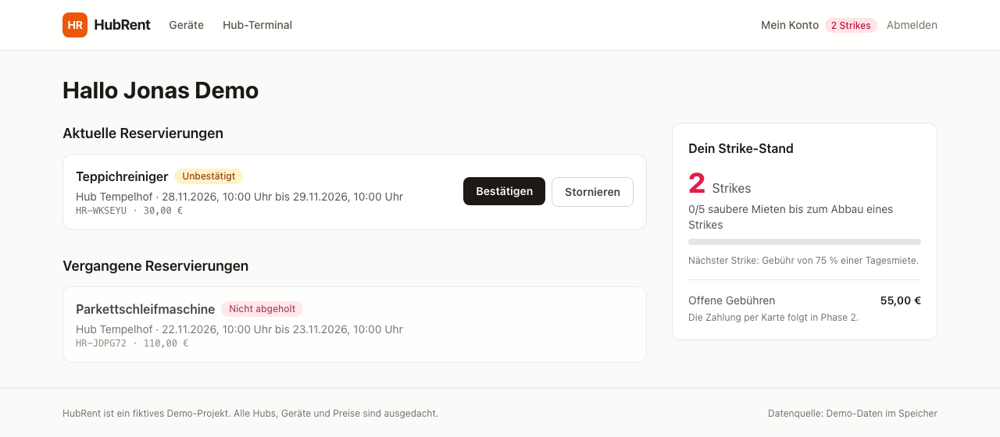
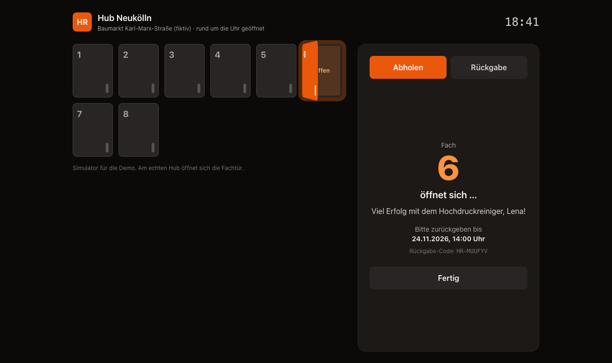
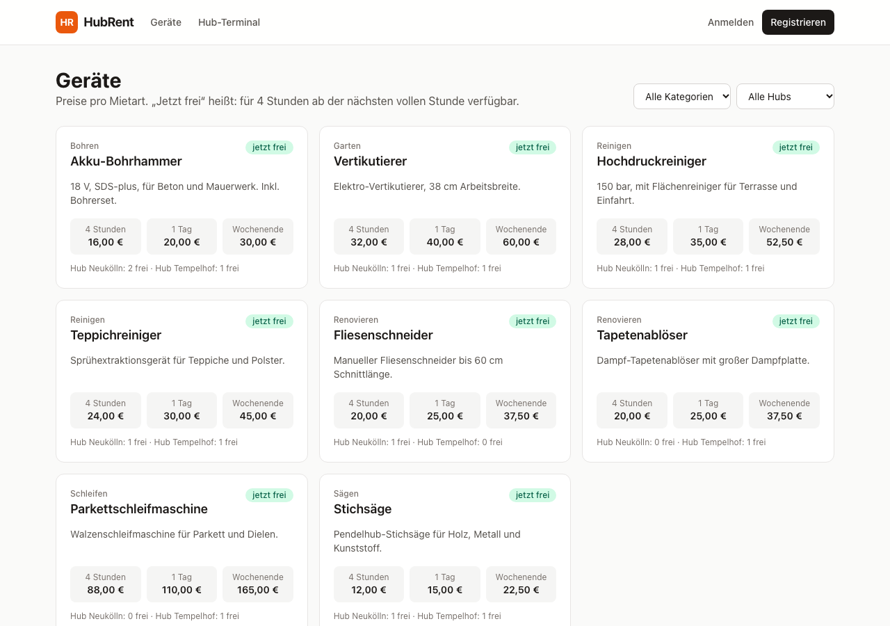
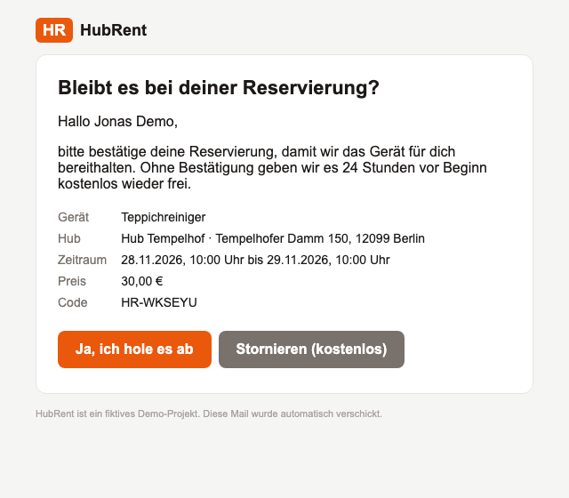
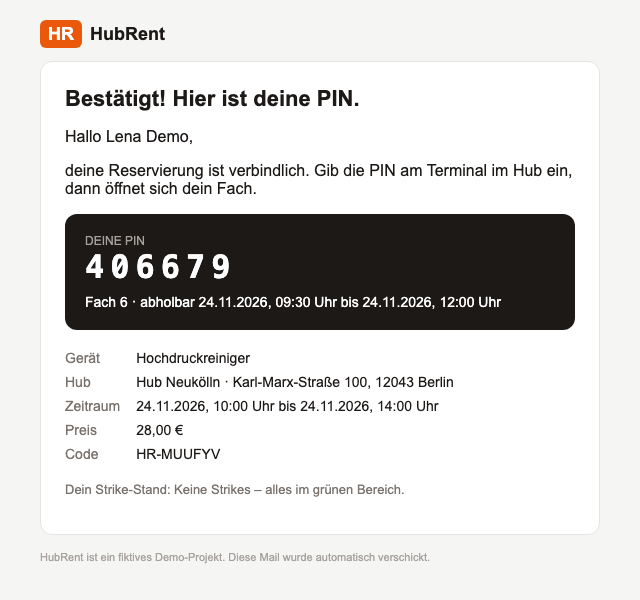
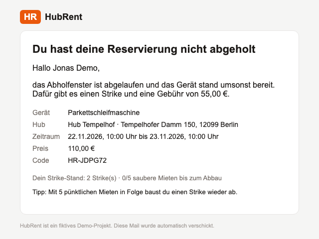

# HubRent: Werkzeugverleih, der sich selbst organisiert

**Prozessautomatisierung mit n8n, Airtable und Flask.** Ein fiktiver Geräteverleih mit Schließfächern im Baumarkt:
online reservieren, rund um die Uhr per PIN abholen. Erinnern, Bestätigen, Freigeben, No-Shows erkennen und ein faires
Strike-System laufen **ohne manuelles Nachfassen**.



> Arbeitsprobe für die Werkstudentenstelle *Automation Manager*. Alle Namen, Hubs, Geräte und Preise sind ausgedacht.

## Das Problem

Reservierungen, die nicht abgeholt werden, blockieren Geräte, die andere gebraucht hätten. Ohne Automatisierung
telefonieren Disponenten Kunden hinterher: zeitaufwendig, und abends oder am Wochenende gar nicht.

## Die Lösung

> **n8n entscheidet, *wann* etwas passiert. Flask entscheidet, *ob* es erlaubt ist.**



| Workflow | Auslöser | Was passiert |
|---|---|---|
| **WF-01 Mail Dispatcher** | Webhook von Flask | Secret prüfen → passende Mail bauen → Gmail; parallel EventLog in Airtable |
| **WF-02 Erinnerung T-48h** | jede Minute | Airtable-Suche → Flask erzeugt neue Links → Mail „Bitte bestätigen“ |
| **WF-03 Deadline T-24h** | jede Minute | noch unbestätigt → Flask gibt kostenlos frei → Mail „freigegeben“ |
| **WF-04 No-Show-Check** | jede Minute | nicht abgeholt → Flask: Strike + Gebühr → Mail mit Strike-Stand |
| **WF-99 Error Handler** | Fehler in WF-01 bis 04 | Admin-Mail mit Workflow, Node und Fehlermeldung |

**➜ Wie Geschäftsregeln und Workflows zusammenhängen, Node für Node: [n8n/README.md](n8n/README.md)**

Was die Automatisierung robust macht:

- **Idempotent:** Doppelte Treffer oder Wiederholungen nach einem Timeout ändern nichts (`"changed": false`). Keine doppelten Strikes, Gebühren oder Mails.
- **Eine Stelle für alle Mails:** Vorlagen in [`n8n/src/mail_templates.js`](n8n/src/mail_templates.js), in Tests mit echten Daten aus Flask gerendert.
- **Fehler werden sichtbar:** Jeder Workflow meldet an WF-99. Fällt nur das Protokollieren aus, gehen die Kundenmails trotzdem raus.
- **Ohne Code anpassbar:** Fristen kommen aus der Konfiguration, Texte stehen in WF-01. Ein Demo-Modus lässt den ganzen Ablauf in unter 10 Minuten laufen.
- **Abgesichert:** Shared Secrets in beide Richtungen, keine Credentials in den Workflow-Dateien.

## Die Regeln

| | |
|---|---|
| **Buchung > 48 h vorher** | erst *unbestätigt*; 48 h vorher kommt eine Erinnerung mit Bestätigen-/Storno-Link |
| **Bis 24 h vorher bestätigt** | verbindlich, PIN per Mail; sonst automatische, kostenlose Freigabe |
| **Buchung ≤ 48 h vorher** | sofort verbindlich, PIN sofort |
| **Abholen** | 30 min vor bis 2 h nach Start am Hub-Terminal, sonst No-Show |
| **Strikes** | No-Show oder Storno < 24 h vorher. 1. Strike: Verwarnung · 2.: 50 % einer Tagesmiete · ab 3.: 75 %. Fünf pünktliche Mieten in Folge bauen einen Strike ab. |

## So sieht es aus

| Buchung mit Live-Preis | Mein Konto mit Strike-Karte |
|---|---|
|  |  |

| Hub-Terminal: PIN eingeben, Fach öffnet sich | Gerätekatalog |
|---|---|
|  |  |

| Erinnerung (WF-02) | PIN-Mail (WF-01) | No-Show (WF-04) |
|---|---|---|
|  |  |  |

## Schnellstart

**Nur die App ansehen** (Demo-Daten im Speicher, ohne Airtable und n8n):

```bash
python3 -m venv .venv && .venv/bin/pip install -r requirements.txt
.venv/bin/flask --app app:create_app run --port 8000
```

http://localhost:8000 öffnen. Demo-Logins: `lena@hubrent-demo.example`, `jonas@hubrent-demo.example` (1 Strike),
`mira@hubrent-demo.example` (3 Strikes), Passwort `hubrent-demo`.

**Komplett mit Airtable und n8n** (10 Schritte):

1. Docker Desktop starten, Repository klonen.
2. `cp .env.example .env`, alle `bitte-…`-Werte durch Zufallswerte ersetzen (z. B. `python3 -c "import secrets; print(secrets.token_urlsafe(32))"`).
3. Airtable: leere Base anlegen, Personal Access Token erstellen ([Scopes](docs/setup.md#airtable-einrichten)), `AIRTABLE_API_TOKEN` und `AIRTABLE_BASE_ID` in die `.env`.
4. `MAIL_FROM`, `ADMIN_EMAIL` und optional `SEED_EMAIL_BASE` (deine Gmail-Adresse) in die `.env`.
5. `python3 -m venv .venv && .venv/bin/pip install -r requirements.txt`
6. `.venv/bin/python -m scripts.setup_airtable` und `.venv/bin/python -m scripts.seed`
7. `docker compose up -d --build` → App auf http://localhost:8000, n8n auf http://localhost:5678 (Owner-Konto anlegen).
8. `docker compose exec n8n n8n import:workflow --separate --input=/workflows`
9. In n8n die Credentials *SMTP* (Gmail-App-Passwort) und *Airtable Personal Access Token* anlegen und in den Nodes auswählen.
10. WF-99 und WF-01 aktivieren; WF-02 bis WF-04 nur für Demo und Tests ([Demo-Skript](docs/demo-script.md)).

Details zu interner API, Airtable-Schema und n8n-Einrichtung: [docs/setup.md](docs/setup.md).

## Aufbau

```
app/
├── domain/        Regeln ohne I/O: Preise, Statusmaschine, Fristen, Strikes, Verfügbarkeit
├── services/      Anwendungsfälle: buchen, bestätigen, stornieren, No-Show, Abholen, Rückgabe
├── repository/    Datenzugriff: Airtable (mit Cache und Retry) oder In-Memory
└── web/           Flask: Oberfläche, Hub-Terminal, interne API für n8n
n8n/               Workflows (JSON) und Mail-Vorlagen
scripts/           Airtable-Setup, Demo-Daten, Workflow-Generator, Screenshots
tests/             über 230 Tests, ohne Netzwerk (Airtable als Fake, Mail-Vorlagen über Node.js)
docs/              How-to-Guide, Demo-Skript, Setup, Spezifikation
```

**Technik:** Python 3.12 · Flask 3 · Airtable (pyairtable) · n8n · Docker · Tailwind + HTMX · pytest

**Konzepte im Code:**

- **Statusmaschine** ([`rules.py`](app/domain/rules.py)): erlaubte Übergänge als Tabelle, alles andere wirft `InvalidTransition`.
- **Uhr als Parameter:** Jede Regel bekommt `now` übergeben, so sind Fristen ohne Tricks testbar.
- **Repository-Pattern** ([`base.py`](app/repository/base.py)): Services kennen nur die Schnittstelle, nicht Airtable.
- **Decorator als Cache** ([`cached_repo.py`](app/repository/cached_repo.py)): spart Airtable-Aufrufe, eigene Änderungen sind sofort sichtbar.
- **Idempotente API** ([`internal_api.py`](app/web/internal_api.py)): Wiederholungen sind gefahrlos.
- **Sicherheit:** Geld als `Decimal`, Tokens und Passwörter nur gehasht, CSRF-Schutz, kein Statuswechsel per GET, PIN-Sperre nach 5 Fehlversuchen.

## Tests

```bash
.venv/bin/python -m pytest -q
```

Getestet werden Regeln, Services, Airtable-Anbindung (gegen eine Fake-API), Web-Seiten, die interne API, die n8n-Workflow-Dateien
(Struktur, Airtable-Formeln) und die Mail-Vorlagen. Ein Test belegt, dass jeder Demo-Ablauf in unter 10 Minuten durchläuft.

## Dokumente

- [How-to-Guide](docs/how-to.md): Problem, Lösung, Workflows, Business-Impact (Schätzung), Grenzen
- [n8n: vom Konzept zum Workflow](n8n/README.md)
- [Demo-Skript](docs/demo-script.md): Drehbuch fürs 2-Minuten-Video
- [Setup und technische Details](docs/setup.md)

## Grenzen und nächste Schritte

- Airtable kennt keine Transaktionen: Gleichzeitige Buchungen werden per Nachkontrolle abgefangen.
- Airtable-Gratis-Tarif (1.000 Aufrufe/Monat): Die Cron-Workflows laufen nur zur Demo. Direkte Stammdaten-Änderungen in Airtable sieht die App wegen des Caches nach spätestens 5 Minuten.
- Gebühren werden erfasst, aber noch nicht eingezogen.
- **Phase 2:** Stripe (Testmodus), Admin-Dashboard mit No-Show-Quote, KI-Geräteberater (OpenAI), Make.com-Rechnungsworkflow, Warteliste.

## Lizenz

[MIT](LICENSE): frei verwendbar, auch kommerziell, mit Namensnennung.
