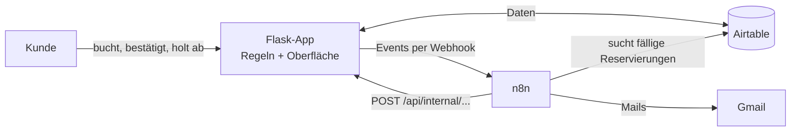
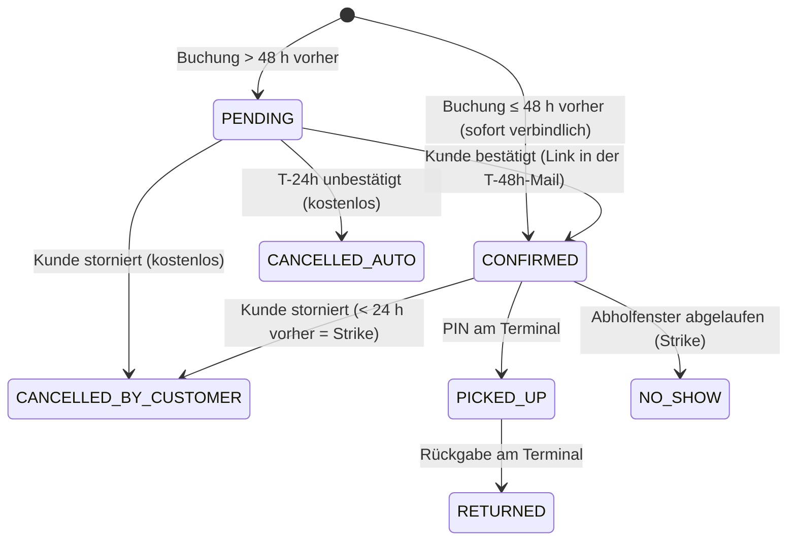

# HubRent: Reservierungen automatisch bestätigen statt hinterhertelefonieren

*Arbeitsprobe für die Werkstudentenstelle Automation Manager. HubRent ist fiktiv, alle Namen, Hubs und Preise sind ausgedacht.*

## 1. Das Problem

Ein Vermieter stellt Werkzeug in **Schließfach-Hubs im Baumarkt** bereit, abholbar rund um die Uhr per PIN.
Reservierungen ohne Abholung (**No-Shows**) blockieren Geräte, die andere Kunden gebraucht hätten.
Bisher rufen Disponenten Kunden vorher an, um nachzufragen. Das kostet Zeit und funktioniert abends und am Wochenende nicht.

## 2. Die Lösung in einem Satz

**n8n übernimmt die Nachfass-Arbeit vollautomatisch:** Es erinnert, gibt unbestätigte Reservierungen frei, erkennt No-Shows und schreibt
die passenden Mails. Die Flask-App prüft dabei jeden Schritt gegen die Geschäftsregeln, Airtable hält die Daten.

**Arbeitsteilung:** n8n entscheidet, *wann* etwas passiert (Zeitsteuerung). Flask entscheidet, *ob* es erlaubt ist (Regeln).
So lassen sich Abläufe und Mails in n8n ohne Code ändern, ohne dass dabei eine Regel umgangen werden kann.

## 3. Ablauf und Strike-System

| Ereignis | Folge |
|---|---|
| No-Show oder Storno < 24 h vor Start | +1 Strike |
| 1. Strike | Verwarnung, keine Gebühr |
| 2. Strike | Gebühr 50 % einer Tagesmiete |
| ab 3. Strike | Gebühr 75 % einer Tagesmiete |
| 5 pünktliche Rückgaben in Folge | −1 Strike |

Kulanz: Storno innerhalb von 15 Minuten nach der Buchung ist immer kostenlos.

## 4. Die n8n-Workflows

| Workflow | Trigger | Zweck |
|---|---|---|
| **WF-01 Mail Dispatcher** | Webhook (Flask und WF-02 bis 04) | Prüft das Secret, baut die passende Mail (HTML + Klartext), versendet über Gmail und protokolliert ins EventLog. **Alle** Mails entstehen hier. |
| **WF-02 Erinnerung T-48h** | jede Minute | Airtable-Suche nach unbestätigten Reservierungen → Flask erzeugt frische Links → Mail „Bitte bestätigen“. |
| **WF-03 Deadline T-24h** | jede Minute | Noch unbestätigt → Flask gibt frei → Mail „Reservierung freigegeben“. |
| **WF-04 No-Show-Check** | jede Minute | Abholfenster vorbei → Flask setzt No-Show, Strike, Gebühr → Mail mit Strike-Stand. |
| **WF-99 Error Handler** | Error Trigger | Admin-Mail mit Workflow, Node und Fehlermeldung. |

**Fehlerbehandlung und Robustheit**

- **Idempotenz:** Findet ein Cron-Lauf denselben Datensatz zweimal oder wiederholt n8n einen Aufruf, antwortet Flask mit
  `"changed": false`. Es entstehen nie doppelte Strikes, Gebühren oder Mails. Deshalb darf n8n fehlgeschlagene Aufrufe gefahrlos wiederholen (3 Versuche).
- **Fehler werden sichtbar:** Jeder Workflow meldet Fehler an WF-99. Ein Ausfall beim Protokollieren hält den Mailversand nicht auf.
- **Absicherung:** Shared Secrets in beide Richtungen, keine Credentials in den exportierten Workflow-Dateien.
- **Ohne Code anpassbar:** Fristen kommen aus der Konfiguration, Mailtexte stehen an einer Stelle (WF-01).

## 5. Business-Impact (Schätzung)

> Alle Zahlen sind **Annahmen** für ein Beispiel mit 1.000 Reservierungen pro Monat, keine Messwerte.

| Annahme | Wert |
|---|---|
| Reservierungen mit mehr als 48 h Vorlauf | 60 % → 600 Nachfassvorgänge |
| Aufwand pro manuellem Nachfassen (Anruf, Notiz, ggf. zweiter Versuch) | 3 Minuten |
| **Eingesparte Disponentenzeit** | **600 × 3 min = 30 Stunden pro Monat** |

Dazu kommen Effekte, die sich erst im Betrieb messen lassen: weniger blockierte Geräte, weil Unbestätigtes automatisch
24 h vorher frei wird, und weniger No-Shows, weil Strikes und Gebühren Verbindlichkeit schaffen. Messbar wird das über das
EventLog (No-Show-Quote, Anteil automatischer Freigaben).

## 6. Grenzen und nächste Schritte

**Grenzen der Demo**
- Airtable kennt keine Transaktionen: Gleichzeitige Buchungen werden per Nachkontrolle abgefangen (im Grenzfall scheitern beide statt einer Doppelbuchung).
- Airtable-Gratis-Tarif: 1.000 API-Aufrufe pro Monat. Die Cron-Workflows laufen deshalb nur während der Demo.
- Gebühren werden nur erfasst, nicht eingezogen.

**Phase 2**
- Stripe (Testmodus): Kartenhinterlegung ab 3 Strikes, Gebühren einziehen
- Admin-Dashboard: Auslastung, No-Show-Quote, offene Gebühren
- KI-Geräteberater mit OpenAI („Rotweinfleck im Teppich, was brauche ich?“ → Gerät + Hub mit Verfügbarkeit)
- Make.com-Workflow für Rechnungen nach der Rückgabe
- Warteliste: Benachrichtigung, sobald ein Gerät durch Storno frei wird
