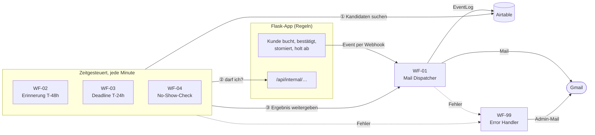
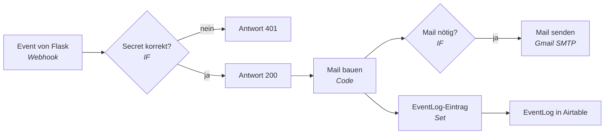
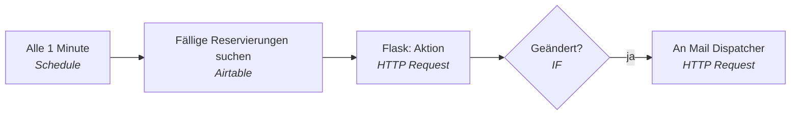
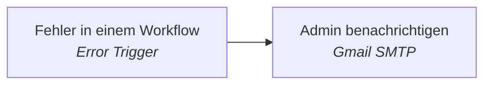
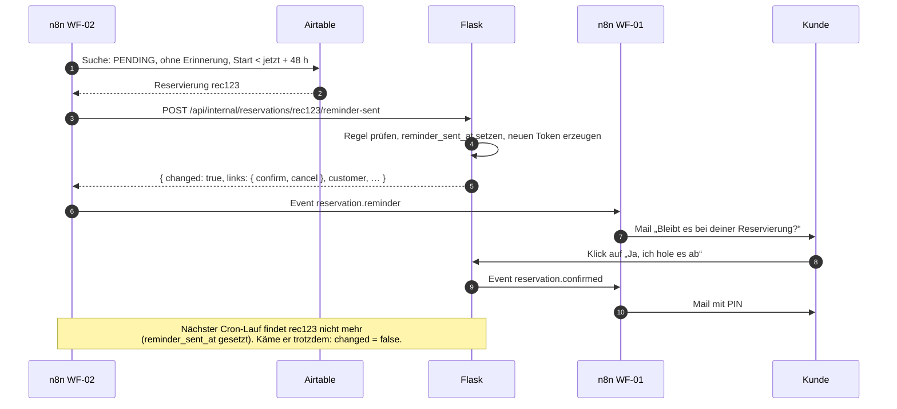
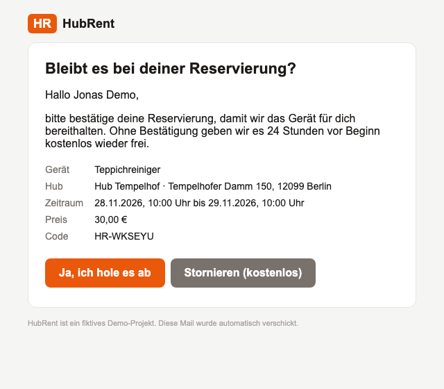
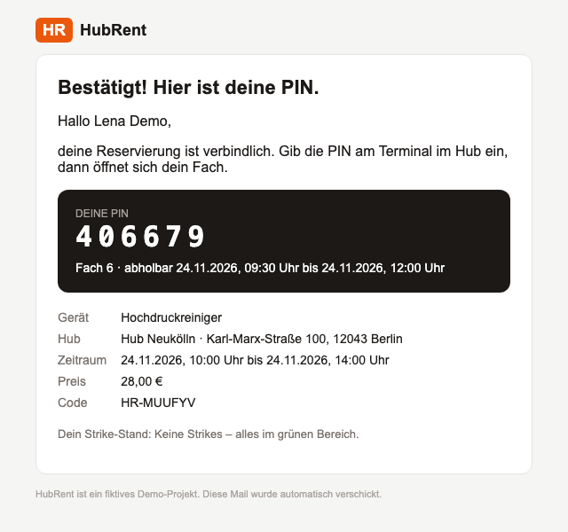
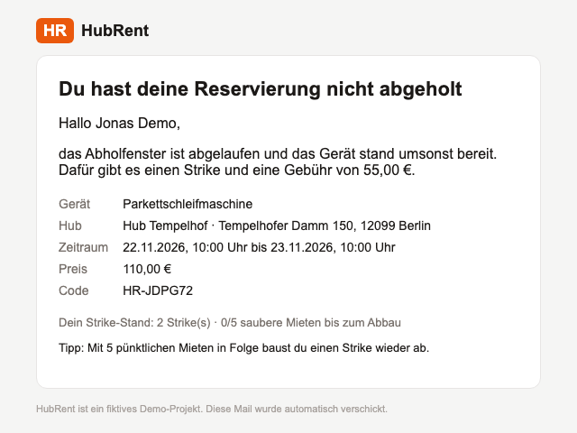

# n8n: vom Konzept zum Workflow

Dieser Ordner zeigt, wie aus den Geschäftsregeln von HubRent konkrete n8n-Workflows werden.
Die Idee dahinter: **Jede Regel, die von der Zeit abhängt oder eine Mail auslöst, hat genau einen Workflow.**
Die Regel selbst (darf das jetzt passieren?) prüft die Flask-App. n8n sorgt dafür, dass sie zum richtigen Zeitpunkt geprüft wird.

```
n8n/
├── README.md                     ← diese Datei: Konzept ↔ Workflows
├── workflows/                    ← importierbare Workflows (ohne Credentials)
│   ├── wf01_mail_dispatcher.json
│   ├── wf02_reminder_t48.json
│   ├── wf03_deadline_t24.json
│   ├── wf04_no_show_check.json
│   └── wf99_error_handler.json
└── src/
    └── mail_templates.js         ← Mail-Vorlagen des Code-Nodes in WF-01 (lesbar und getestet)
```

---

## 1. Das Gesamtbild



Drei Muster, die sich durch alle Workflows ziehen:

| Muster | Wo | Warum |
|---|---|---|
| **Ereignis → Mail** | WF-01 | Alles, was ein Kunde in der App auslöst, kommt als Event an einer Stelle an und wird dort zur Mail. |
| **Zeitsteuerung → Prüfen → Handeln** | WF-02, 03, 04 | Ein Cron findet Kandidaten in Airtable, Flask entscheidet verbindlich, nur bei `changed: true` geht es weiter. |
| **Fehler → Mensch** | WF-99 | Jeder Fehler landet als Mail beim Admin, statt still zu verschwinden. |

---

## 2. Geschäftsregel → Workflow

| Geschäftsregel (aus dem Konzept) | Workflow | Flask-Endpunkt | Mail an den Kunden |
|---|---|---|---|
| Buchung > 48 h vorher ist erst *unbestätigt* | WF-01 (Event `reservation.created`) | – | „Deine Reservierung ist eingegangen“ |
| Buchung ≤ 48 h vorher ist sofort verbindlich, PIN sofort | WF-01 (Event `reservation.confirmed`) | – | „Bestätigt! Hier ist deine PIN“ |
| **48 h vor Start**: einmalig erinnern, mit Bestätigen-/Storno-Link | **WF-02** | `POST …/reminder-sent` | „Bleibt es bei deiner Reservierung?“ |
| Kunde bestätigt per Link → PIN | WF-01 (Event `reservation.confirmed`) | – | PIN-Mail |
| **24 h vor Start** noch unbestätigt → kostenlos freigeben | **WF-03** | `POST …/auto-cancel` | „Deine Reservierung wurde freigegeben“ |
| Storno: kostenlos oder Spätstorno mit Strike | WF-01 (Event `reservation.cancelled`) | – | „Storniert“, ggf. mit Strike und Gebühr |
| **2 h nach Start** nicht abgeholt → No-Show, Strike, Gebühr | **WF-04** | `POST …/no-show` | „Nicht abgeholt“ mit Strike-Stand |
| Rückgabe, ggf. Strike-Abbau nach 5 sauberen Mieten | WF-01 (Events `reservation.returned`, `strike.reduced`) | – | „Danke für die Rückgabe“, „Ein Strike weniger“ |
| Jeder technische Fehler | **WF-99** | – | Admin-Mail |

---

## 3. Die Workflows im Einzelnen

### WF-01 Mail Dispatcher

**Zweck:** Die einzige Stelle, an der Mails entstehen. Änderungen am Text oder Design passieren nur hier.



| Node | Was er tut |
|---|---|
| Event von Flask | Webhook `POST /webhook/hubrent-event`. Empfängt Events von Flask und von WF-02 bis WF-04. |
| Secret korrekt? | Vergleicht den Header `X-HubRent-Secret` mit `N8N_WEBHOOK_SECRET`. Fremde Aufrufe bekommen 401. |
| Antwort 200 | Antwortet **sofort**, damit Flask nie auf den Mailversand warten muss. |
| Mail bauen | Wählt pro Event die Vorlage aus [`src/mail_templates.js`](src/mail_templates.js), baut HTML und Klartext. Events ohne Mail (z. B. `strike.issued`) bekommen `send: false`. |
| Mail senden | Gmail über SMTP mit App-Passwort. |
| EventLog in Airtable | Protokolliert jedes Event. Läuft mit „continue on error“: Fällt Airtable aus, gehen die Mails trotzdem raus. |

### WF-02 Erinnerung T-48h · WF-03 Deadline T-24h · WF-04 No-Show-Check

Alle drei folgen demselben Muster, nur Formel, Endpunkt und Mail unterscheiden sich:



| | WF-02 Erinnerung | WF-03 Deadline | WF-04 No-Show |
|---|---|---|---|
| **Airtable-Formel** | `PENDING`, noch keine Erinnerung, Start < jetzt + 48 h | `PENDING`, Start < jetzt + 24 h | `CONFIRMED`, nicht abgeholt, Start + 2 h < jetzt |
| **Flask-Endpunkt** | `reminder-sent` | `auto-cancel` | `no-show` |
| **Was Flask tut** | setzt `reminder_sent_at`, erzeugt neue Links | Status → `CANCELLED_AUTO` | Status → `NO_SHOW`, Strike, ggf. Gebühr |
| **Event an WF-01** | `reservation.reminder` | `reservation.auto_cancelled` | `reservation.no_show` |

Ausgeschrieben sehen die Formeln so aus (die Zahlen kommen aus der `.env`, im Demo-Modus Minuten statt Stunden):

```
WF-02  AND({status}='PENDING', NOT({reminder_sent_at}), IS_BEFORE({start_at}, DATEADD(<jetzt>, 48, 'hours')))
WF-03  AND({status}='PENDING', IS_BEFORE({start_at}, DATEADD(<jetzt>, 24, 'hours')))
WF-04  AND({status}='CONFIRMED', NOT({picked_up_at}), IS_BEFORE(DATEADD({start_at}, 120, 'minutes'), <jetzt>))
```

### WF-99 Error Handler



In WF-01 bis WF-04 ist WF-99 als *Error Workflow* eingetragen. Die Mail enthält Workflow, Node, Fehlermeldung und einen Link zur Ausführung.

---

## 4. Ein Ablauf von Anfang bis Ende: die Erinnerung



| Erinnerungsmail (WF-02 → WF-01) | PIN-Mail (WF-01) | No-Show-Mail (WF-04 → WF-01) |
|---|---|---|
|  |  |  |

---

## 5. Design-Entscheidungen

- **n8n entscheidet *wann*, Flask entscheidet *ob*.** Die Airtable-Formeln finden nur Kandidaten. Ob der Schritt
  wirklich zulässig ist, prüft Flask. So kann ein falsch eingestellter Cron keine Regel brechen.
- **Idempotenz statt Zustand in n8n.** Ein zweiter Aufruf liefert `changed: false` und tut nichts. Deshalb darf die
  HTTP-Node bei Fehlern wiederholen (3 Versuche), und doppelte Treffer sind harmlos.
- **Eine Mail-Stelle.** WF-02 bis WF-04 bauen keine Mails selbst, sondern geben ihr Ergebnis an WF-01 weiter.
  Textänderungen passieren an einem Ort. Die Vorlagen werden in Tests mit echten Daten aus Flask gerendert.
- **„Jetzt“ kommt von n8n.** Die Formeln nutzen den Zeitstempel des Cron-Laufs statt Airtables `NOW()`, damit das
  Verhalten eindeutig ist.
- **Keine Secrets in den Dateien.** Gmail und Airtable werden nach dem Import als Credentials ausgewählt,
  Shared Secrets kommen aus der Umgebung (`$env`).

## 6. Importieren

```bash
docker compose up -d
docker compose exec n8n n8n import:workflow --separate --input=/workflows
```

Danach in n8n die Credentials *SMTP* (Gmail-App-Passwort) und *Airtable Personal Access Token* anlegen,
in den markierten Nodes auswählen und erst WF-99, dann WF-01 aktivieren. WF-02 bis WF-04 nur für Demo und Tests
aktivieren (Airtable-Gratis-Tarif: 1.000 Aufrufe pro Monat).

Die JSON-Dateien werden mit `python -m scripts.build_n8n_workflows` erzeugt. Wer in der n8n-Oberfläche etwas ändert,
exportiert den Workflow einfach erneut in diesen Ordner.
